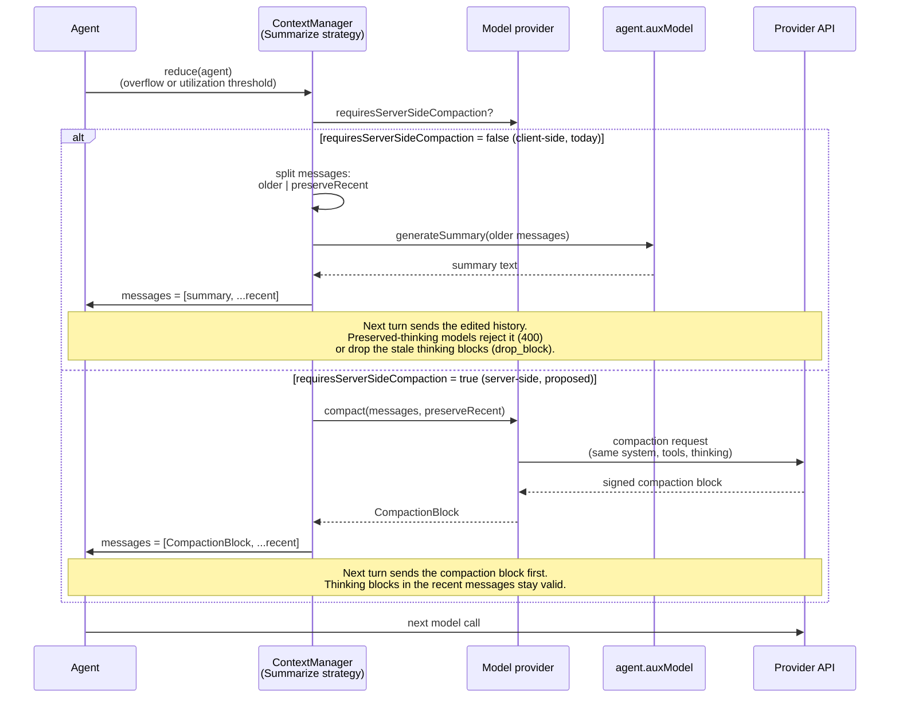

# Server Side Compaction Support

**Date**: 2026-10-14

**Issue**: [#4933](https://github.com/strands-agents/harness-sdk/issues/4933)

**Scope**: Supporting Server Side Context Management Strategies

## Overview

Read: https://platform.claude.com/docs/en/build-with-claude/preserved-thinking

<!-- Is there any mention of thinking blocks in any other design document?  -->

Thinking blocks that are formed by Anthropic Models (Claude Opus 5.5, Claude Fable 5.1, Haiku 5.5, and Sonnet 5.5). Strands Agents SDK accepts a thinking block as a `ReasoningBlock`: 

```typescript
export interface ReasoningBlockData {
    text?: string              // the reasoning text
    signature?: string         // cryptographic signature for verification
    redactedContent?: Uint8Array
  }
```

Each thinking block's `signature` are tied to the prefix, which includes `SystemPrompt`, `ToolsList`, and `ConversationHistory` of the LLM that generated that block. 

When a Strands Agents running in auto mode reaches a context window of 85% capacity, then the agent will summarize the oldest messages and the agent keeps the most recent 4 messages verbatim. This will fail with `preserved_thinking` models. 

Auto mode also truncates tools results automatically which will not affect preserved thinking models because the tool result is mutated before a thinking block sees the tool result. 

This effects customers that use the `"auto"` mode or any that use ContextManagement techniques that ever modify context. This also only effects customers that are using `preserved_thinking` Anthropic models. With this paradigm shift into LLM providers having restrictions on using their native APIs to modify context, there needs to be a universal way to switch to server side context management techniques for the specific LLM provider you are dealing with at that point in time. 

## Problem

Server-side context management ensures that thinking data is private to the LLM provider. More and more LLM providers may follow Anthropic's lead. This affects how Strands modifies `chat_history`, `tools_lists`, and `system_prompts`.

Agent developers are finding new ways to increase agent performance when modifying the context window to save performance. It is a common strategy to limit token usage. How do agent developers continue to modify every bit of data in an agent's context history while respecting LLM provider's restrictions?

Strands modifies content in the context window through the current ContextManagement [methods](https://github.com/strands-agents/harness-sdk/tree/main/strands-ts/src/context-manager/methods). These functions will be affected by Anthropic's preserved thinking changes.

### Current State

Strands has no concept of preserved-thinking compatibility today. Dropping thinking blocks is effectively how context reduction already behaves: when a context-reduction strategy removes or rewrites a message, any `ReasoningBlock` inside it is simply dropped from the next request's history — nothing recognizes that the block's `signature` is tied to a prefix that must stay intact.

The one place reasoning content gets special treatment today is at the sub-message (block) level: [`BaseOffloadStrategy._blockMatchesTarget`](https://github.com/strands-agents/harness-sdk/blob/main/strands-ts/src/context-manager/strategies/offload/base.ts) explicitly excludes `ReasoningBlock` from being targeted by per-block offload strategies, so block-level truncate/drop strategies skip over thinking content rather than editing it in place. There is no equivalent protection at the *message* level: the message-level `Offload.drop`/`Offload.summarize` strategies remove or replace whole messages without checking whether a dropped message carries a thinking block tied to the live prefix. 

## Proposal

For the first part of this solution, the summarizer method for Anthropic models with Preserved Thinking will be written to go through the Claude Native API. This will allow for server side context management and then Anthropic will not return a 400 error. 

## Approach 1: Server-side context management versus client-side context management

Anthropic's preserved thinking models will return a 400 if the prefix of a thinking block has been modified. This check means that in our SDK, whenever summarize is called and preserved thinking is enabled, Strands needs to summarize the conversation through Claude's API. 

There needs to be a flag that is triggered when the LLM provider running requires provider-side context management. There needs to be a universal way for components of the `ContextManager` to interact with the context of an agent even if it needs to be done through a provider's API.

The SDK needs a path in the `ContextManagement` techniques which tells the context manager that it needs to modify context through the provider. This path needs to allow for various model providers. There needs to be a flag set during an agent session that indicates when the contextManager needs to refer to the model provider code for how to modify context. 

To trigger this path, the following change is proposed to the `Model` class: 

```typescript
export interface BaseModelConfig {
  // ...existing fields

  /**
   * Whether context reduction must go through the provider's server-side compaction.
   *
   * @defaultValue false
   */
  requiresServerSideCompaction?: boolean
}

export abstract class Model<T extends BaseModelConfig = BaseModelConfig> {
  get requiresServerSideCompaction(): boolean {
    return this.getConfig().requiresServerSideCompaction ?? false
  }
}

```




The branch lives in `SummarizeStrategy`, so `Offload.drop` and `Offload.truncate` keep their current behavior. `BaseOffloadStrategy` only gains a field for whether a strategy edits content the model has already seen:

```typescript
export abstract class BaseOffloadStrategy implements ContextStrategy {
  // ...existing fields and methods

  /**
   * Whether this strategy edits content the model has already seen.
   * Eager per-block offloading rewrites a message before the next model call, so it never is.
   */
  protected readonly _isRetroactive: boolean

  constructor(target?: OffloadTarget, conditions?: OffloadConditions) {
    // ...existing assignments
    this._isRetroactive = this._isMessageLevel || this._preserveRecent > 0
  }
}
```

`_isRetroactive` is set once in the constructor, next to the other `OffloadConditions` fields ([`base.ts`](https://github.com/strands-agents/harness-sdk/blob/main/strands-ts/src/context-manager/strategies/offload/base.ts#L330-L343) / `base.py`). A message-level strategy always rewrites history the model has already seen. A per-block strategy does too when `preserveRecent > 0`, because the preserved blocks were already sent.

Auto mode's tool-result truncation runs eagerly, when the result is added and before the model sees it, so it doesn't affect preserved thinking. A truncate strategy with `preserveRecent > 0` instead truncates results the model has already seen, which invalidates later thinking blocks.

`Model` gets a non-abstract `compact()` that throws by default, so `SummarizeStrategy` can call it without importing `AnthropicModel`, the only provider that overrides it. The parameters mirror `OffloadConditions`. `utilization` is passed through only for logging, since `apply()` has already decided to compact. `preservedMessages` takes the same count-or-ratio as `preserveRecent` and sets the cut point. The cut respects pinned messages and never separates a `toolUse` from its `toolResult`. `instructions` carries the strategy's custom summarization prompt (`SummarizeConfig.systemPrompt`) into the provider's compaction instructions. In Python the signature is `compact(messages, *, utilization=None, preserved_messages=0, instructions=None)`.

```typescript
export abstract class Model<T extends BaseModelConfig = BaseModelConfig> {
  // ...existing fields and methods

  /**
   * Reduces context through the provider's server-side compaction. Only implemented by providers
   * whose `requiresServerSideCompaction` is `true` — `AnthropicModel` is the only one today.
   *
   * @param messages - Full conversation history; `compact` picks its own cut point from `preservedMessages`.
   * @param conditions - `utilization` (diagnostics/logging only — gating already happened in the strategy),
   *   `preservedMessages` (count, or ratio in (0, 1), of trailing messages to keep verbatim), and
   *   `instructions` (a custom summarization prompt sent as the provider's compaction instructions;
   *   the request's system prompt is left unchanged).
   * @returns `[CompactionBlock message, ...preserved messages]`, or `undefined` if there was nothing to compact.
   */
  async compact(
    messages: Message[],
    conditions: { utilization?: number; preservedMessages?: number; instructions?: string }
  ): Promise<Message[] | undefined> {
    throw new Error(`${this.constructor.name} does not implement server-side compaction`)
  }
}
```

`SummarizeStrategy` routes retroactive summarization to the provider when the model requires it:

```typescript
export class SummarizeStrategy extends BaseOffloadStrategy {
  // ...existing fields and methods

  override async apply(context: ContextState): Promise<boolean> {
    const model = this._resolveModel(context.agent) // this._config.model ?? context.agent.auxModel
    if (this._isRetroactive && model?.requiresServerSideCompaction) {
      return this._applyServerSide(context, model)
    }
    if (!model) {
      logger.warn('no model available for summarization')
      return false
    }
    return super.apply(context)
  }

  /**
   * Reduces context through the provider's server-side compaction, so thinking blocks
   * in the preserved messages stay valid.
   *
   * `model` is the already-resolved model from `apply()` — the same one the gating check
   * ran against — so this never falls back to `context.agent.model` behind the customer's
   * back if they configured `agent.auxModel`.
   */
  private async _applyServerSide(context: ContextState, model: Model): Promise<boolean> {
    const { messages, utilization } = context
    // Gating already happened in apply(); utilization is passed through for
    // AnthropicModel's own logging, not re-checked here.
    const compacted = await model.compact(messages, {
      utilization,
      preservedMessages: this._preserveRecent,
      instructions: this._config.systemPrompt, // the strategy's custom summarization prompt, if set
    })
    if (!compacted) return false // provider produced no summary, so leave the history unchanged

    messages.splice(0, messages.length, ...compacted) // [compaction block, ...recent]
    return true
  }
}
```

### Summarize

Anthropic's answer to vended context modification is compaction. The public surface, `Offload.summarize(target).when({ utilization, preserveRecent })`, does not change. Behind it, `apply()` resolves the model as it does today (`this._config.model ?? agent.auxModel`). If `_isRetroactive` is set and that model's `requiresServerSideCompaction` is `true`, `SummarizeStrategy` calls `model.compact(...)` instead of generating a client-side summary. A customer who set `agent.auxModel` is still routed there, and `agent.model` is never read directly. `compact()` takes the customer's existing conditions as-is, so there is no second API to learn.

If the strategy was configured with a custom `systemPrompt`, `compact()` sends it as the compaction request's `instructions`. It can't replace the request's `system`, which must match the live conversation for the thinking blocks to stay valid.

Anthropic rejects a compaction request whose system prompt or tools differ from the live conversation.

### Modifying Tool Lists

Tool lists are tied. 

TODO


### System Prompt

System prompts are tied. How do we modify these? 

TODO

#### Implementation: Part 1 

For part 1 of this fix we will focus on the `Summarizer` implementation for the case when server side compaction must be utilized in. 

**Scope of Part 1**: the only behavior change is inside the summarizer path (`SummarizeStrategy`). When `model.requiresServerSideCompaction` is `true`, that path calls Anthropic's native compaction function instead of generating a client-side summary; when it's `false`, behavior is unchanged. Tool list mutation and system prompt mutation (Implementation: Part 2, below) are explicitly out of scope here — those paths are untouched by Part 1 and will still error, or silently drop thinking blocks, on preserved-thinking models until Part 2 is designed.

#### Compaction Block Type

Anthropic allows LLM users to call Claude Native API to "compact" a conversation. Compacting does not allow for the amount of control that the Strands SDK provides in terms of summarizing a re-shaping context. In order to avoid dropping thinking blocks, Strands needs to use Anthropic's `compact` function to modify the context otherwise 400 errors will be returned by Anthropic. 

The SDK needs to allow for a CompactionBlock datatype, matching the shape Anthropic's SDK already returns (`BetaCompactionBlock`/`BetaCompactionBlockParam` — `content`, `signature`, optionally `encrypted_content`):

```typescript
/**
 * Data for a compaction block: a provider-generated summary that replaces a prefix of the
 * conversation. Round-tripped verbatim — Strands never edits a CompactionBlock it didn't just
 * receive from `Model.compact`.
 */
export interface CompactionBlockData {
  /**
   * Provider-generated summary of the conversation prefix this block replaces, or `undefined`
   * when the provider reports the compaction failed (callers treat this the same as `compact`
   * returning `undefined`: leave the history unchanged).
   */
  content?: string

  /**
   * Provider signature binding the summary to the history it was generated from.
   * Must be sent back unchanged.
   */
  signature?: string

  /** Opaque provider metadata from a prior compaction. Round-tripped verbatim; never inspected. */
  encryptedContent?: string
}
```

Python's `ContentBlock` TypedDict gains the equivalent `compaction: CompactionContentBlock` key (`content`, `signature`, `encrypted_content`), alongside the existing `reasoningContent`, `toolUse`, etc. keys.


#### API Changed in Model Class

We want to expose a new field in the `Model` class. 

```typescript
// strands-ts/src/models/model.ts
export interface BaseModelConfig {
  contextWindowLimit?: number
  requiresServerSideCompaction?: boolean // Default should be not supported, also should have ModelConfig attached
}
```
`Model.compact` is only implemented for Anthropic models with preserved thinking turned on. No other provider uses it at this time.

The new field `requiresServerSideCompaction` will be set to true for models that have preserved thinking and the ability to call a compaction API. Whenever a context management strategy implements a summary, the SDK needs to privately use Claude's Native API to manage the summarization otherwise future calls to the LLM will need to drop thinking blocks (this degrades performance significantly).

Previously Strands would only implement context management techniques on the client side, but with the preserved thinking models, thinking blocks need to be tied to the prefix that created the thinking block. Any modification to the history results in an error. Anthropic allows for summarization through compaction. Strands needs to use Anthropic's compaction functions privately so that Strands users can still use the context management strategies. 

#### Codebase changes

Where is the "path" checked in the codebase for summarize to function normally to users?

- python: `strands/_context_manager/strategies/offload/base.py` (`BaseOffloadStrategy.__init__` sets `_is_retroactive`) and `strands/_context_manager/strategies/offload/summarize.py` (`SummarizeStrategy.apply` branches on it). The provider call lives in `strands/models/anthropic.py` (`AnthropicModel.compact`).
- typescript: `strands-ts/src/context-manager/strategies/offload/base.ts` (`BaseOffloadStrategy` constructor sets `_isRetroactive`) and `strands-ts/src/context-manager/strategies/offload/summarize.ts` (`SummarizeStrategy.apply`). The provider call lives in `strands-ts/src/models/anthropic.ts` (`AnthropicModel.compact`).


### Implementation: Part 2

#### Tools lists

TODO

#### System prompts

TODO

### Implementation: Part 3

Server-side summarization through compaction blocks with additional model providers. 

OpenAI compaction block implementation

## Developer Experience

The goal of this design is to allow Strands users to use the context management techniques with any LLM, and preserved thinking should not effect this. 

The Developer Experience is unchanged other than a new field on the model config. To use an Anthropic preserved-thinking model (Claude Fable 5.1, Haiku 5.5, Sonnet 5.5, and Opus 5.5 for now) and still summarize the conversation, summarization has to happen server-side. Users enable server-side compaction through the Claude Native API by setting `requiresServerSideCompaction` to `true`:

```typescript
import { Agent } from '@strands-agents/sdk'
import { Offload } from '@strands-agents/sdk/experimental'
import { AnthropicModel } from '@strands-agents/sdk/models/anthropic'

const agent = new Agent({
  model: new AnthropicModel({
    modelId: 'claude-fable-5-1',
    params: { thinking: { type: 'adaptive' } },
    requiresServerSideCompaction: true, // the only new line
  }),
  contextManager: {
    strategies: [
      // Unchanged: on this model, summarization is routed to AnthropicModel.compact()
      Offload.summarize('*').when({ utilization: 0.8, preserveRecent: 4 }),
    ],
  },
})
```

A custom summarization prompt works the same on both paths. On this model it becomes the compaction request's `instructions`:

```typescript
Offload.summarize('*', { systemPrompt: 'Keep file paths and decisions.' }).when({ utilization: 0.8, preserveRecent: 4 })
```

Without the flag, the same agent runs a client-side summary and the next request fails with a 400, because the kept thinking blocks no longer match the conversation that produced them.

## Open Questions

-[x] How can we align Anthropic compact API with our API's — resolved for Part 1: `AnthropicModel.compact(messages, { utilization, preservedMessages })` mirrors `OffloadConditions` field-for-field (see Approach 1 above), so `Offload.summarize(...).when(...)` is the only API customers need to learn.

-[] Summarize between each thinking block

-[] How will context injector be utilized? 

-[] Will there need to be different compaction blocks for different providers? 

-[] So we can edit the history that is not associated with a thinking block? 
  -[] Should there be protected_history? History/prefixes that are associated with a thinking block? 


-[] What about users that use Anthropic through bedrock and do not have an Anthropic API key? Will they fail silently, or do we need a new error? 

-[] **Model resolution for server-side compaction must go through `agent.auxModel`, not `agent.model`, directly** — fixed in Approach 1 above (`apply()` now resolves once via `this._config.model ?? agent.auxModel` and reuses that same model for both the gating check and the `compact()` call, matching `agent.auxModel`'s [existing fallback to `agent.model`](https://github.com/strands-agents/harness-sdk/blob/1adcaf9fbf5f7709d25e5eb061e368527b48bb4c/strands-py/src/strands/agent/agent.py#L733) when the customer never set one). Still open: **what happens when `agent.aux_model` is explicitly set to a *different* model than the one that actually produced the conversation's thinking blocks?** Preserved-thinking signatures are cryptographically bound to the exact model + prefix (system prompt, tools, history) that generated them — compacting through a different model may not be able to validate those signatures at all, independent of whether the resolution logic is correct. Options to decide: (a) call `compact()` on the resolved model anyway and let the provider reject it, surfacing whatever error it returns; (b) detect the mismatch and fall back to `agent.model` with a warning; (c) treat it as a configuration error and fail fast before making the request. None of these is implemented yet — Part 1 only fixes *which* model gets resolved, not what to do when the resolved model can't be the one validating the signature.

-[] What happens when `agent.aux_model` differs from the model that is generating the existing thinking blocks? Measured for Opus 5.5 → Haiku 5.5 on Bedrock: Haiku compacted the history in 18 of 18 runs and the kept thinking stayed valid (see "Server-Side Compaction Performance with Different `aux_model`" below). Other model pairs are untested.

-[] Should summarization happen between individual thinking blocks? (could we have another level of depth in the summaries with this?)

-[] How do we ensure that when we make a compaction request, that the system prompt and tools do not differ from the live conversation? How does compaction know when they differ from the live conversation? 

-[] The compaction request carries the live tool list, so the model may call a tool instead of summarizing. Should `AnthropicModel.compact()` append "Do not call tools." to `instructions` (as cloudflare-os does), send `tool_choice: {"type": "none"}`, or both? Anthropic's preserved-thinking docs say to use `tool_choice: none` rather than removing tools. It isn't part of the checked prefix, but it hasn't been confirmed that compaction requests accept it.

-[] **Pinned messages ahead of the cut.** The compaction block has to open the history, and the kept turns must follow it exactly as they were, so a pinned message can't be kept verbatim ahead of the block. When a pin sits before every possible cut point (for example a pinned first task message), `compact()` skips compaction and logs a warning, and the context keeps growing. Options: fold the pinned content into the compaction `instructions` so the summary retains it, fall back to client-side summarization for that call, or document pins as incompatible with native compaction.

## Alternative: Recompute `_isRetroactive` via a getter

Instead of deriving `_isRetroactive` once in the constructor, `BaseOffloadStrategy` could expose it as a getter that re-derives the value from `OffloadConditions` on every `apply()` call.

- **Pros:** Keeps `apply()` as the single place that reasons about the strategy's conditions; nothing to keep in sync if a subclass mutated its conditions after construction.
- **Cons:** `OffloadConditions` fields (`threshold`, `utilization`, `preserve_recent`) are already read exactly once, at construction, into `readonly` fields — a getter would recompute a value from inputs that never change after `__init__`/the constructor runs, which is both wasted work and inconsistent with how every other derived field on the strategy is handled. Rejected in favor of a plain field set once in the constructor.

## Alternative: Abstract `Model.compact()` implemented by every provider

Instead of a non-abstract hook that only throws by default, `compact()` could be declared `abstract` on `Model`, forcing every provider subclass to implement it.

- **Pros:** The type system guarantees every provider has *some* `compact()` implementation; no risk of forgetting to override the throwing default.
- **Cons:** Only Anthropic's preserved-thinking models need server-side compaction today; making it abstract would force every other provider (Bedrock, OpenAI, etc.) to add a dead-code override that only throws, for a capability they don't have. The non-abstract hook that throws from the base class gives generic strategy code (`model.compact(...)`) the same call site without that busywork, and keeps the one real implementation where it belongs, on `AnthropicModel`.

## Alternative: Categorizing Prefixes as Protected? 

## Alternative: Drop Thinking Blocks

Anthropic does not recommend


## Additional Details


<details>
<summary>Where does Strands summarize things in the SDK code?</summary>

There is three places where the Strands SDK implements some kind of summarization technique which alters conversation history and will error out on Anthropic's Preserved Thinking models: 

#: 1
Entry point: SummarizingConversationManager.reduce()
Shared helper it calls: generateSummary / generate_summary
TS: conversation-manager/summarizing-conversation-manager.ts (SummarizingConversationManager.reduce)
Python: agent/conversation_manager/summarizing_conversation_manager.py (SummarizingConversationManager._generate_summary)
────────────────────────────────────────
#: 2
Entry point: summarize_context tool (agentic context mode)
Shared helper it calls: generateSummary / generate_summary, called with
agent.auxModel
TS: context-manager/modes/agentic/agentic-context.ts (summarizeContext)
Python: _context_manager/modes/agentic/agentic_context.py (summarize_context)
────────────────────────────────────────
#: 3
Entry point: Offload.summarize(...) → SummarizeStrategy; the
proactiveSummarization preset uses it
Shared helper it calls: summarizeContent / _summarize_content
TS: context-manager/strategies/offload/summarize.ts (SummarizeStrategy.apply)
Python: _context_manager/strategies/offload/summarize.py (SummarizeStrategy.apply)

Note: function/method names above are more durable than line numbers, which drift as the
files change. Verify against the current `main` branch rather than trusting this appendix
to stay perfectly in sync.

</details>


<details>
<summary>Client-side summarization that stays valid on preserved-thinking models</summary>

Server-side compaction is not the only way to summarize on a preserved-thinking model. Anthropic's [preserved thinking docs](https://platform.claude.com/docs/en/build-with-claude/preserved-thinking) also describe client-side summaries that pass the prefix check. This is a candidate fallback for when `Model.compact()` is unavailable (Bedrock, a proxy or gateway, or a failed compaction request), instead of leaving the history unchanged.

**Why a client-side summary normally fails.** Each thinking block is checked against the `system`, `tools`, and `messages` that came before it when it was generated. A keep-tail summary (summarize the older turns, keep `preserveRecent` turns verbatim) replaces the history the kept turns' thinking was generated against, so those blocks fail. Anthropic calls this out directly: "If you write the summary yourself, the kept turns' thinking fails the check, because those blocks were produced against the history you replaced."

**Thinking generated after the summary is valid.** New thinking is bound to the compacted history, not the original. From the docs: "Thinking the model produces from this request onward follows the summary and stays valid." Only the blocks that were already in the history before the swap fail.

**Three ways to summarize client-side without a 400:**

1. **Simple compaction (Anthropic's recommendation for client-side compaction).** Replace the entire history with one user message containing the summary and the next instruction. No earlier thinking is replayed, so nothing is checked.

    ```json
    [{ "role": "user", "content": "<summary of the session so far>\n\n<the next instruction>" }]
    ```

2. **Keep-tail with thinking stripped.** Summarize the older turns as today, then remove `thinking` and `redacted_thinking` blocks (Strands' `ReasoningBlock`) from the preserved messages, keeping their `text` and `toolUse` blocks. Removing all thinking blocks is a valid edit, so this works without any beta header. This matches `preserveRecent` most closely.

3. **Keep-tail with `drop_block`.** Leave the history as-is and send `thinking.block_binding.prefix_mismatch_behavior: "drop_block"` (beta `thinking-binding-controls-2026-08-01`). The API drops the failing blocks and reports them in `input_transformations`. The setting must stay on for as long as the kept turns remain in history.

**Cost.** All three lose the reasoning in the summarized or kept turns, once per compaction, and the model regenerates what it needs. Anthropic measured `drop_block` firing once per session at +2.5% (low effort) to +20.1% (max effort) output tokens on a multi-turn coding benchmark, and +4.6% to +67.1% when firing on every turn. A single strip at compaction time is closest to the once-per-session figure.

**Conditions for the new thinking to stay valid:**

- The summary message is sent unchanged on every later request. It is never re-rendered.
- `system` and `tools` do not change after the swap.
- History stays append-only until the next compaction.
- The cut never falls between a `toolUse` and its `toolResult`.
- The summary is swapped in synchronously. A summary built in the background fails every turn produced while it was being built, the same way keep-tail does.

**How this compares to server-side compaction.** On-demand compaction (`compact-2026-09-04`) keeps the preserved turns' thinking valid, so the model keeps that reasoning. The client-side options trade that reasoning for working on any provider, including Bedrock.

</details>


<details>
<summary>How other agent harnesses use native compaction, and what it suggests for Strands</summary>

Several open-source harnesses already call Anthropic's on-demand compaction (`compact-2026-09-04`): [docker-agent](https://github.com/docker/docker-agent) (`pkg/model/provider/anthropic/compaction.go`), [gptme](https://github.com/gptme/gptme) (`gptme/tools/autocompact/native_anthropic.py`), [cloudflare-os](https://github.com/cloudflare/cloudflare-os) (`packages/workshop-backend/src/anthropic-compaction.ts`), and [oh-my-pi](https://github.com/can1357/oh-my-pi) (`packages/ai/src/providers/anthropic-wire.ts`). None of them works around the signature check. They use the paths Anthropic supports: server-side compaction, `drop_block` as a fallback, simple client-side compaction, and server-side context editing.

Suggestions for `Model.compact()` based on how they do it:

1. **Expose `instructions` on `compact()`.** The `compaction` request field accepts an optional `instructions` string for a custom summarization prompt. docker-agent, gptme, and cloudflare-os all pass it through. cloudflare-os also appends "Do not call tools." because the request carries the live tool list, and the model may call a tool instead of summarizing. Incorporated into Approach 1: `compact()` takes `instructions`, filled from the strategy's `SummarizeConfig.systemPrompt`. The tool-call question is tracked in Open Questions.

2. **Check `stop_reason` and that exactly one compaction block came back.** docker-agent treats the response as valid only if `stop_reason == "compaction"` and `content` holds exactly one `compaction` block. Strands' `compact()` takes the first `compaction` block it finds, if any. A response that ends for another reason (for example, a tool call) should be treated as "nothing compacted".

3. **Decide what a failed `compact()` falls back to.** Strands returns `undefined` and leaves the history unchanged, so the context keeps growing until the next trigger. gptme falls back to its generic client-side summary instead. Candidate fallbacks are simple client-side compaction (see "Client-side summarization that stays valid on preserved-thinking models" above) or server-side context editing (`clear_thinking_20251015` and `clear_tool_uses_20250919`, beta `context-management-2025-06-27`), which does not count as an edit to the prefix.

4. **Consider checking support through the Models API.** gptme checks `client.beta.models.retrieve(model).capabilities.compaction.summarize.supported` and caches the answer per model. A failed lookup turns native compaction off and falls back. cloudflare-os uses a hard-coded list of models instead. Strands relies only on the `requiresServerSideCompaction` config flag, so a user can set it on a model or endpoint that does not support compaction and only find out when the request fails.

5. **Bedrock is still unsolved.** Every harness above limits native compaction to the Claude API itself. docker-agent rejects any other provider, and gptme turns it off behind a proxy or gateway. This matches the open question on Bedrock customers without an Anthropic API key. The client-side options above work on Bedrock, at the cost of the reasoning in the summarized turns. On-demand compaction did work on Bedrock through `AsyncAnthropicBedrock` in every eval run (see "Server-Side Compaction Performance with Different `aux_model`" below), even though Anthropic's documentation doesn't list Bedrock as supported. Whether that support is intended or stable is unconfirmed.

</details>


<details>
<summary>SimpleAgent code for testing</summary>

```python
"""Minimal Strands agent with one custom tool."""

import logging

from rich import pretty

from strands import Agent, tool
from strands.models import BedrockModel

pretty.install()

logging.basicConfig(format="%(levelname)s | %(name)s | %(message)s", level=logging.WARNING)
# Strands internals: model request/response handling, tool execution, event loop.
logging.getLogger("strands").setLevel(logging.DEBUG)
# botocore.endpoint logs the full request body sent to Bedrock; the rest of botocore is mostly noise.
logging.getLogger("botocore.endpoint").setLevel(logging.INFO)


@tool
def word_count(text: str) -> int:
    """Count the number of words in a piece of text.

    Args:
        text: The text to count words in.
    """
    return len(text.split())


model = BedrockModel(
    model_id="global.anthropic.claude-sonnet-4-6",
    region_name="us-west-2",
)


# model = BedrockModel(
#     model_id="global.anthropic.claude-opus-5-5",
#     region_name="us-west-2",
#     max_tokens=8000,
#     additional_request_fields={"thinking": {"type": "adaptive"}},
# )

agent = Agent(
    model=model,
    system_prompt="You are a concise, helpful assistant.",
    tools=[word_count],
    callback_handler=None,
)

if __name__ == "__main__":
    # result = agent("How many words are in 'the quick brown fox jumps over the lazy dog'?")
    # print("\n\nstop_reason:", result.stop_reason)
    pass

```

</details>

<details>
<summary>Calling Compaction Over Anthropic's API</summary>

This coding example calls summarize, but sends it over the Claude's Native API compact.

Simple agent code with a hook to log context window capacity: 

```python


```

Getting Summarizer to trigger from utilization

```python


agent("Suppose you’re on a game show, and you’re given the choice of three doors: Behind one door is a gold bar; behind the others, rotten vegetables. You pick a door, say No.1, and the host asks you “Do you want to pick door No.2 instead?” Is it to your advantage to switch your choice?")


agent("Which weighs more, a pound of water, two pounds of bricks, a pound of feathers, or three pounds of air")

agent("Sally (a girl) has 3 brothers. Each brother has 2 sisters. How many sisters does Sally have?")

agent("Write me a sentence without any words that appear in The Bible.")


```

</details>


<details>
<summary>Anthropic code changes in appendix for API implementation</summary>

When the signature does not match the prefix of a thinking block Anthropic responds to the request with this with the following error: 

See Anthropic troubleshooting for more information on error

Does Anthropic changes effect only the previous thinking block or all in the `chat_history`?

What does Anthropic check exactly?

The following is Anthropic's example for how compaction can be called with preserving recent messages: 
https://platform.claude.com/docs/en/build-with-claude/compaction-keep-recent-turns

TODO: The following is the code added to anthopic's model code in the SDK to implement the compact function. 


</details>

</details>


<details>
<summary>400 Errors when Conversation is Summarized Client Side</summary>

This script demostrates the error Strands users will see when Offload.summarize starts. 

```python


"""Check whether ContextManager's message-level Offload.drop breaks preserved thinking.

ConversationManager (and SlidingWindowConversationManager specifically) is being deprecated
in favor of ContextManager. This is the ContextManager equivalent of sliding_window_thinking.py:
``Offload.drop("*").when(utilization=..., preserve_recent=4)`` is message-level (because it has
a `utilization` condition), so it physically removes whole old messages the same way
SlidingWindowConversationManager does -- it just does it through the new strategy API.

With preserve_recent=4, the manager drops the oldest messages after turn 3. Any thinking block
that survives the drop has lost part of its prefix, so turn 4 should return a 400 if Bedrock
enforces the prefix (or silently drop the block if it does not).
"""

import logging

from simple_agent import model, word_count

from strands import Agent
from strands.experimental.context_manager import ContextManager, Offload

logging.getLogger("strands").setLevel(logging.INFO)
logging.getLogger("strands._context_manager").setLevel(logging.DEBUG)

PROMPTS = [
    "A bat and a ball cost $1.10 total. The bat costs $1.00 more than the ball. What does the ball cost?",
    "If 5 machines make 5 widgets in 5 minutes, how long do 100 machines take to make 100 widgets?",
    "A lily pad patch doubles daily and covers the lake on day 48. On what day was it half covered?",
    "Summarize the three answers you gave so far in one line each.",
    "Which of those puzzles is the most commonly answered wrong, and why?",
]


def thinking_indices(agent: Agent) -> list[int]:
    """Return the indices of messages that contain a thinking block."""
    return [i for i, m in enumerate(agent.messages) if any("reasoningContent" in c for c in m["content"])]


def first_text(agent: Agent) -> str:
    """Return the start of the first message's text, for sanity-checking what survived the drop."""
    content = agent.messages[0]["content"]
    return next((c["text"][:80] for c in content if "text" in c), "")[:80]


agent = Agent(
    model=model,
    system_prompt="You are a concise, helpful assistant.",
    tools=[word_count],
    # Message-level: utilization condition routes this to _apply_per_message, which removes
    # whole Message entries (same mechanism SlidingWindowConversationManager uses), rather than
    # the per-block path (which already skips reasoningContent blocks).
    context_manager=ContextManager(strategies=[Offload.drop("*").when(utilization=0.0, preserve_recent=4)]), # this potentially needs to be Offload.summarize perhaps
    callback_handler=None,
)

if __name__ == "__main__":
    for turn, prompt in enumerate(PROMPTS, start=1):
        print(f"\n=== turn {turn}: {prompt[:60]!r}")
        try:
            result = agent(prompt)
        except Exception as error:
            print(f"ERROR on turn {turn}: {type(error).__name__}: {error}")
            raise SystemExit(1) from None
        print(
            f"turn {turn}: stop_reason={result.stop_reason} messages={len(agent.messages)} "
            f"thinking_at={thinking_indices(agent)} first={first_text(agent)!r}"
        )

```

</details>

<details>
<summary>Server-Side Compaction Performance with Different `aux_model`</summary>

This eval compares summary quality and thinking continuity across three ways of summarizing an Opus 5.5 conversation. It ran live against Bedrock (us-west-2) on PR #5287 at `5da3dd698`. The eval code is in [this gist](https://gist.github.com/jimbrub/fdd8a24b0c31e29874c5659e2e40e7eb).

| Arm | Summarizer | Path |
|---|---|---|
| `native_same` | `aux_model` unset, so Opus 5.5 | `AnthropicModel.compact()` |
| `native_haiku` | `aux_model` = Haiku 5.5 | `AnthropicModel.compact()` on Haiku, over Opus's history |
| `client_drop` | `aux_model` = Opus 5.5, `requires_server_side_compaction=False` | client-side summary, then the SDK's `drop_block` retry |

**Setup.** The main agent is Opus 5.5 with adaptive thinking at effort `high`. Each of 6 scripted scenarios plants 7–10 facts through `lookup` tool calls, runs a reasoning turn whose thinking lands in the preserved tail, and compacts once with `Offload.summarize("*").when(utilization=..., preserve_recent=3)`. Three more turns follow: a recall probe, a numeric reasoning probe, and a follow-up that replays the post-compaction thinking. The native arms set `thinking.block_binding.prefix_mismatch_behavior: "error"`, so an invalid thinking block fails the request instead of being dropped silently. Every request carries the `thinking-binding-controls-2026-08-01` beta, so any dropped block is reported in `input_transformations` and can be attributed to the exact block. 3 reps per scenario, 54 runs in total.

| | `native_same` | `native_haiku` | `client_drop` |
|---|---|---|---|
| Compaction applied | 18/18 | 18/18 | 18/18 |
| Pre-compaction thinking blocks replayed / dropped | 72 / 0 | 84 / 0 | 90 / 72 |
| Post-compaction thinking blocks replayed / dropped | 72 / 0 | 80 / 0 | 106 / 0 |
| Runs with a binding 400 (then `drop_block`) | 0 | 0 | 18 |
| Summary quality, LLM judge (0–1) | 0.96 | 0.95 | 0.96 |
| Facts kept in the summary | 0.98 | 0.94 | 0.99 |
| Recall probe / reasoning probe | 1.00 / 1.00 | 1.00 / 1.00 | 1.00 / 1.00 |
| Output tokens per run (after compaction) | 2,650 (716) | 2,726 (763) | 3,288 (938) |
| Compaction latency | 5.6 s | 4.6 s | 5.5 s |

The judge is Sonnet 5.5. It scores completeness and faithfulness against the summarized messages and the system prompt, and checks that the text is a summary rather than an answer to the pending request.

**Findings.**

- **Server-side compaction keeps preserved thinking valid.** Under `prefix_mismatch_behavior: "error"`, every native run replayed its pre-compaction thinking after the compaction block with no 400s and no dropped blocks. Thinking produced after compaction also replayed cleanly.
- **A different `aux_model` can compact the history.** Haiku 5.5 compacted Opus 5.5's signed history in 18 of 18 runs, and Opus then continued with its earlier thinking intact. Summary quality was on par with Opus compacting its own history. Haiku's summaries were slightly less faithful: one run added a "Corrections" section for retractions the assistant never made. At $0.10 per million input tokens against Opus's $4.00, Haiku is a cheap compactor. This was measured for Opus 5.5 to Haiku 5.5 on Bedrock only.
- **The client-side path summarizes just as well but loses the reasoning.** Its summaries scored the same as native ones. But every run hit a binding 400, and the `drop_block` retry discarded 72 of 90 pre-compaction thinking blocks (80%). Those runs used about 24% more output tokens overall, and about 31% more after compaction, consistent with the model regenerating the reasoning it lost.
- **Native compaction works on Bedrock.** Every run went through `AsyncAnthropicBedrock`, even though Anthropic's documentation lists on-demand compaction as unavailable on Bedrock.
- **The client-side summarizer request is malformed.** The first summarization request was rejected in all 18 `client_drop` runs (`tool_use` blocks in a user message), and fell back to a text-only summary. See the summarizer bug noted on PR #5287.

**Limits.** The conversations are short (about 20k input tokens summed across all of a run's requests), and each compacts only once. The recall and reasoning probes scored 1.00 in every arm, partly because the preserved tail restates many of the facts, so they don't separate the arms. Haiku's lower fact score comes from one scenario where the agent found the invoice record only after the cut, so those facts were never in the summarized messages. The run doesn't measure the direct Claude API, other model pairs, or repeated compaction.

</details>

<details>
<summary>Notes</summary>

Strands implements a `ContextManager` which allows users to do several things with their agent's context windows:

- Truncate
- Summarize
- Drop
- Emergency Truncation
- Agentic/model-driven editing (has 3 tools)
    - `summarize_context`
    - `truncate_context`
    - `pin_context`

Context management techniques that the Strands Agents SDK utilizes are going to return a 400 error when using models with preserved thinking (currently Fable 5.1, Sonnet 5.5, Haiku 5.5, and Opus 5.5). Preserved thinking requires that when a `thinking_block` is created, then the entire prefix (system prompt, tool list, and chat history) needs to remain the same turn over turn when sending requests to Anthropic. 

See appendix for information on where in the Strands SDK a summary method is implemented. 

</details>